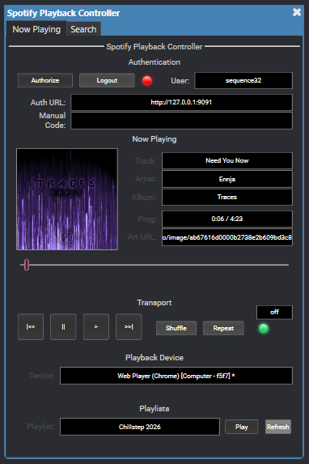
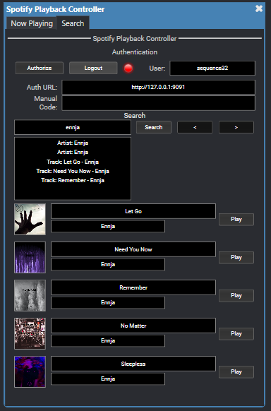

# Spotify Playback Controller for Q-SYS

A professional Q-SYS plugin that provides full Spotify playback control through the Spotify Web API. Features OAuth PKCE authentication (no client secret needed), transport controls, now-playing metadata with inline album art display, a visual progress meter, playlist browsing, device selection, and a Spotify-branded dark UI theme.


> **🚧 Active Development** — This plugin is under active development as of April 2026. Features, controls, and authentication flows may change between versions. Feedback and contributions are welcome!

## Screenshots

| Now Playing | Search |
|:-----------:|:------:|
|  |  |

---

## Features

- **OAuth PKCE Authentication** — Secure login without exposing client secrets
- **Mobile-Friendly Login** — Browse to the Core's IP from any device; includes a code-paste fallback for remote auth
- **Inline Album Art** — Album artwork rendered directly in the plugin using Q-SYS Media controls
- **Visual Progress Bar** — Horizontal meter that tracks song playback in real time
- **Spotify-Themed UI** — Dark mode with Spotify green (#1DB954) accent colors on all controls
- **Transport Controls** — Play, Pause, Next, Previous, Shuffle, Repeat
- **Now Playing** — Track name, artist, album, progress text, and duration
- **Playlist Browsing** — Dropdown menu of your top playlists with auto-play on selection
- **Device Selection** — Dropdown menu to switch between Spotify Connect devices, featuring 30-second auto-refresh and unique ID tags for duplicate names
- **Scrolling Search List** — Search-as-you-type across tracks, albums, artists, and playlists in one list with art, scrolled by a fader, up/down buttons, or page buttons. Results are cached on the Core so scrolling is instant
- **Auto Token Refresh** — Tokens refresh automatically before expiry
- **Persistent Login** — The refresh token is saved on the Core so the plugin reconnects by itself after a reboot or redeploy
- **Full URL Paste** — Paste an entire redirect URL when manually entering auth codes; the plugin auto-extracts the code

---

## Prerequisites

- **Q-SYS Designer** 9.x or later
- **Spotify Premium** account (required for Web API playback control)
- A registered app in the [Spotify Developer Dashboard](https://developer.spotify.com/dashboard)

---

## Setup Guide

### Step 1 — Create a Spotify Developer App

1. Go to the [Spotify Developer Dashboard](https://developer.spotify.com/dashboard)
2. Log in with your Spotify account
3. Click **Create App**
4. Fill in:
   - **App Name**: anything (e.g., `Q-SYS Controller`)
   - **App Description**: anything
   - **Redirect URI**: `http://127.0.0.1:9091/callback`
   - **APIs Used**: check **Web API**
5. Click **Save**
6. Copy the **Client ID** from the app overview page

> **Why loopback?** Spotify only accepts plain-HTTP redirect URIs on the loopback address (`127.0.0.1`). A LAN address like `http://192.168.1.6:9091/callback` is rejected by the dashboard. The plugin sends the loopback address to Spotify and separately shows the Core's real LAN address in the **Auth URL** field, which is what the client types into their phone. If you change the port, change it in both the dashboard and the **Redirect Port** property.

### Step 2 — Install the Plugin in Q-SYS Designer

1. Copy `Spotify_Playback_Controller.qplug` to your Q-SYS plugins directory
2. Open your design in Q-SYS Designer
3. Find **Spotify Playback Controller** in the plugin list and drag it into your design

### Step 3 — Configure Plugin Properties

In the plugin's **Properties** panel, set:

| Property | Value | Notes |
|----------|-------|-------|
| **Client ID** | `your-spotify-client-id` | From the Spotify Developer Dashboard |
| **Core IP Address** | *(leave blank)* | The address shown in **Auth URL**. Leave blank to auto-detect the Core's LAN A address, or set it if the Core has several interfaces. A loopback value here is ignored for display |
| **Redirect Host** | `127.0.0.1` | The host sent to Spotify in the redirect URI. Leave at loopback unless you have registered an HTTPS redirect |
| **Redirect Port** | `9091` | Must match the port in your Spotify redirect URI |
| **Poll Interval (s)** | `3` | How often to poll for now-playing updates (1-10 seconds) |
| **Search Rows** | `8` | How many search result rows the plugin exposes (5 to 15). Changing this re-creates the search controls |

### Step 4 — Authorize

#### From the same machine (Emulator)

1. Save/Emulate your design so the plugin is running
2. Press the **Authorize** button on the plugin block
3. Open `http://127.0.0.1:9091` in a browser on the same machine
4. Click the green **"Step 1: Log in with Spotify"** button
5. Log in to Spotify and approve the permissions
6. Spotify redirects to the loopback address, the plugin catches it, and you'll see "Spotify Authorized!" — done!

#### From a phone or another device (deployed Core)

1. Press the **Authorize** button on the plugin
2. The **Auth URL** field shows the Core's LAN address, e.g. `http://192.168.1.6:9091`. Give this to the client
3. On the phone, open a browser and go to that address
4. Tap **"Step 1: Log in with Spotify"** — this opens Spotify auth in a new tab
5. Log in and approve permissions
6. Spotify sends the phone to `127.0.0.1`, which the phone can't reach, so the page won't load. **This is expected.**
   - **Copy the entire URL** from that tab's address bar
   - Go back to the landing page tab
   - **Paste the full URL** into the input field under "Step 2"
   - Tap **Submit Code**
7. You can also paste the full URL directly into the **Manual Code** field in the Q-SYS plugin

> **Tip:** You only need to authorize once. The plugin refreshes the token before it expires and saves the refresh token on the Core, so it reconnects by itself after a reboot. Re-authorization is only needed after an explicit logout or if Spotify revokes the token.

---

## Controls Reference

### Authentication
| Control | Type | Description |
|---------|------|-------------|
| `Authorize` | Trigger | Start the OAuth login flow |
| `Logout` | Trigger | Clear tokens and stop polling |
| `Auth_Status` | LED Indicator | Green = authenticated, Red = logged out, Yellow = waiting |
| `Auth_URL` | Text (output) | Login page URL — open in any browser on the network |
| `Auth_Code_Input` | Text (input) | Paste a full redirect URL or raw auth code here as fallback |
| `User_Name` | Text (output) | Logged-in Spotify display name |

### Transport
| Control | Type | Description |
|---------|------|-------------|
| `Play` | Trigger | Resume playback |
| `Pause` | Trigger | Pause playback |
| `Next` | Trigger | Skip to next track |
| `Previous` | Trigger | Go to previous track |
| `Shuffle` | Toggle | Enable/disable shuffle mode |
| `Repeat` | Trigger | Cycle repeat: off → context → track → off |
| `Repeat_State` | Text (output) | Current repeat mode |
| `Is_Playing` | Indicator | True when playback is active |

### Now Playing
| Control | Type | Description |
|---------|------|-------------|
| `Track_Name` | Text (output) | Current track name |
| `Artist_Name` | Text (output) | Artist(s), comma-separated |
| `Album_Name` | Text (output) | Album name |
| `Album_Art_URL` | Text (output) | HTTPS URL for album artwork |
| `Album_Art` | Media (output) | Inline album art display rendered directly in the plugin |
| `Progress_Ms` | Meter 0-100% (output) | Visual progress bar tracking playback position |
| `Progress_Text` | Text (output) | Formatted as `2:34 / 4:12` |
| `Duration_Ms` | Text (output) | Track duration in milliseconds |

### Device & Seek
| Control | Type | Description |
|---------|------|-------------|
| `Active_Device` | Text (output) | Name of the active Spotify Connect device |
| `Device_ID` | Text (output) | Device ID (for debugging) |
| `Seek_Position` | Knob 0-100% (input) | Seek to a percentage of the track |

### Playlists & Devices
| Control | Type | Description |
|---------|------|-------------|
| `Refresh_Playlists` | Trigger | Fetch/refresh the user's playlists |
| `Playlist_Select` | ComboBox (input) | Dropdown to select a playlist (auto-plays on change) |
| `Playlist_Play` | Trigger | Start playing the selected playlist |
| `Device_Select` | ComboBox (input) | Dropdown to switch active playback device (auto-refreshes every 30s) |

### Search
| Control | Type | Description |
|---------|------|-------------|
Results are fetched once per query (10 tracks, 10 albums, 10 artists, 10 playlists) and cached on the Core. The `Search_Result_* 1-N` controls are a window into that cache; every scroll control just moves the window. N is the **Search Rows** property.

| Control | Type | Description |
|---------|------|-------------|
| `Search_Query` | Text (input) | Type to search. A search runs half a second after typing stops |
| `Search_Execute` | Trigger | Run the search immediately (bind to a keyboard "Go" if needed) |
| `Search_Clear` | Trigger | Empty the query and the result list |
| `Search_Count` | Text (output) | `1-8 of 39`, `No results`, `Not signed in`, or blank |
| `Search_Scroll` | Knob 0-100% (both) | Scrollbar. 0% is the top of the list, 100% the bottom. Bind to a vertical fader on a UCI |
| `Search_Up` / `Search_Down` | Trigger | Scroll by one row |
| `Search_Prev` / `Search_Next` | Trigger | Scroll by one page (N rows) |
| `Search_Result_Art 1-N` | Media (output) | Art for the row (album cover, artist photo, or playlist cover) |
| `Search_Result_Name 1-N` | Text (output) | Title of the row |
| `Search_Result_Artist 1-N` | Text (output) | Subtitle: artists for tracks and albums, follower count for artists, owner for playlists |
| `Search_Result_Album 1-N` | Text (output) | Extra line: album name for tracks, release year for albums, track count for playlists |
| `Search_Result_Type 1-N` | Text (output) | `Track`, `Album`, `Artist`, or `Playlist` |
| `Search_Result_Play 1-N` | Trigger | Play the row. Tracks play the single track; albums, artists, and playlists play as a context |

Removed in v1.5.0: `Search_Suggestions`. Remove that binding from any existing UCI.

---

## UCI Integration

### Album Art on Touch Panels

The plugin renders album art directly in the plugin block using a **Media** style control. For UCI integration:

1. Add a **Media Display** element to your UCI layout
2. Set its source to the `Album_Art_URL` control
3. The plugin outputs HTTPS image URLs that Q-SYS can render natively

### Search List

Lay out N rows, each with a Media Display bound to `Search_Result_Art n`, text fields for `Search_Result_Name n` and `Search_Result_Artist n`, and a button bound to `Search_Result_Play n`. Make the button transparent and stretch it over the whole row so the row itself is the tap target. Add a vertical fader bound to `Search_Scroll` beside the rows, or up/down buttons bound to `Search_Up` and `Search_Down`.

Art is loaded by the touch panel straight from Spotify's image CDN, so panels on a network with no internet access will show blank art even though the text fills in.

---

## Plugin UI Layout

The plugin features a Spotify-themed dark interface with the following sections:

| Section | Description |
|---------|-------------|
| **Authentication** | Authorize/Logout buttons, auth status LED, user name, auth URL, manual code input |
| **Now Playing Tab** | 140x140 album art, track/artist/album metadata, progress text, and draggable progress meter bar |
| **Transport** | Play, Pause, Previous, Next buttons with Spotify green styling; Shuffle/Repeat toggles |
| **Active Device** | Currently active Spotify Connect device name |
| **Playlists** | ComboBox dropdown for playlist selection with auto-play on selection |
| **Devices** | ComboBox dropdown for device selection with auto-refresh and unique device IDs |
| **Search Tab** | Search box with Clear and Go, result count, page buttons, N result rows (art, title, subtitle, type badge, Play), and a vertical scroll fader with up/down buttons |

---

## Troubleshooting

| Issue | Solution |
|-------|----------|
| **"redirect_uri: Not matching"** | The dashboard redirect URI must be exactly `http://127.0.0.1:9091/callback` (or your port), matching the **Redirect Host** and **Redirect Port** properties |
| **Auth URL shows 127.0.0.1** | Set **Core IP Address** to the Core's LAN address. The plugin ignores loopback there and auto-detects, so this only happens if no non-loopback interface was found |
| **Phone shows "can't reach this page" after login** | Expected. Copy the URL from that tab and paste it into Step 2 on the landing page |
| **Search shows "Not signed in"** | Authorize first. Search needs a valid token |
| **Search rows are blank after changing Search Rows** | The property re-creates the row controls. Re-bind any UCI elements that pointed at removed rows |
| **"Invalid authorization code"** | Auth codes are single-use. Press Authorize again for a fresh code |
| **Transport buttons not working** | Ensure you have an active Spotify session on at least one device |
| **No album art in plugin** | The `Album_Art` control uses Media style — verify the plugin is receiving valid image URLs |
| **Plugin not loading / silent failure** | Check for syntax errors; ensure no unsupported Unicode characters in the .qplug file |
| **Plugin crashes on Authorize** | Check that the Client ID is set in Properties and the Core IP Address is correct |
| **Token expires after 1 hour** | Handled automatically — the plugin refreshes 60 seconds before expiry |

---

## Architecture

```
+-----------------------------------------------------+
|  Q-SYS Core / Designer Emulation                    |
|                                                     |
|  +---------------------------------------------+   |
|  |  Spotify Playback Controller Plugin          |   |
|  |                                              |   |
|  |  TcpSocketServer (:9091)                     |   |
|  |    |-- Serves login landing page             |   |
|  |    |-- Catches OAuth redirect callback       |   |
|  |    +-- Accepts manual code submission        |   |
|  |                                              |   |
|  |  HttpClient                                  |   |
|  |    |-- Token exchange & refresh              |   |
|  |    |-- Playback control (PUT/POST)           |   |
|  |    +-- Metadata polling (GET)                |   |
|  +---------------------------------------------+   |
|                                                     |
|  Browser (phone, tablet, or PC)                     |
|    +-- Opens login page at http://<core-ip>:9091    |
|    +-- Spotify OAuth -> redirect to 127.0.0.1       |
|    +-- Same machine: caught automatically           |
|    +-- Phone: paste the redirect URL into Step 2    |
+-----------------------------------------------------+
         |                          |
         v                          v
  Spotify Auth Server        Spotify Web API
  (accounts.spotify.com)     (api.spotify.com)
```

---

## Security Notes

- **No client secret stored** — Uses PKCE (Proof Key for Code Exchange), the recommended flow for public/embedded clients
- **Refresh token is stored on the Core** — Saved in a hidden control and in `/tmp` on the Core so the plugin reconnects after a reboot. It is stored in plain text; anyone with Designer access to the file or Core can read it. Logout wipes it
- **Scopes are minimal** — Only requests permissions needed for playback control and playlist reading

---

## Changelog

### v1.5.0
- **Scrolling search list:** One query returns tracks, albums, artists, and playlists in a single list, cached on the Core. Scroll with the `Search_Scroll` fader, `Search_Up`/`Search_Down`, or page with `Search_Prev`/`Search_Next`, all without re-querying
- **Search-as-you-type:** Results refresh half a second after typing stops. `Search_Execute` still forces an immediate search; `Search_Clear` empties everything
- **Richer rows:** New `Search_Result_Type` and populated `Search_Result_Album` per row; artists show follower counts, playlists show owner and track count
- **Search Rows property:** Choose 5 to 15 visible rows
- **Play anything:** Playing an album, artist, or playlist row starts it as a context; tracks play as a single track
- **Removed:** `Search_Suggestions` listbox (superseded by the live list)

### v1.4.6
- **Auth URL shows the Core's LAN address:** Spotify requires the loopback redirect, but the client needs the real address to reach the login page from a phone. New **Redirect Host** property (default `127.0.0.1`) feeds Spotify; **Core IP Address** or auto-detect feeds the Auth URL
- **Persistent login:** Refresh token is saved on the Core and used to reconnect automatically after a reboot or redeploy
- Landing page copy reworded so the failed redirect on a phone reads as the expected step

### v1.4.5
- **Tabbed Interface:** Reorganized the UI into "Now Playing" and "Search" tabs
- **Advanced Search:** Added dedicated search interface with album art and direct play buttons
- **Search Pagination:** Added Next/Prev buttons to browse more than 5 results at a time
- **Autocomplete Suggestions:** Live dropdown populates with top artist/track matches as you type
- **ComboBox Dropdowns:** Replaced bulky slot grids for Devices and Playlists with clean dropdown menus
- **Auto-Play Playlists:** Selecting a new playlist from the dropdown now automatically starts playback
- **Device Refresh:** Devices dropdown now automatically refreshes in the background every 30 seconds
- **Unique Device IDs:** Appended short ID strings to identical device names (e.g. "Web Player") so they can be distinguished

### v1.4.3
- Accept full redirect URL paste in both Manual Code field and web form (auto-extracts auth code)
- Simplified landing page instructions for non-technical users

### v1.4.2
- Enhanced auth landing page with step-by-step instructions and code-paste form
- Added `/submit_code` route for manual auth from mobile devices
- Removed QR code feature (caused plugin loading issues)

### v1.3.2
- Fixed Lua parse error from Unicode escape sequences in button legends
- Replaced Unicode symbols with ASCII text for Q-SYS compatibility

### v1.3.0
- Added inline album art display using Q-SYS Media controls
- Added visual progress meter bar tracking song playback
- Applied Spotify-themed dark UI with green accent colors to all buttons and controls
- Added device selection (5 slots) with playback transfer

### v1.2.0
- Added Album Art control with Media style rendering

### v1.1.0
- Initial release with OAuth PKCE, transport controls, playlists, and now-playing metadata

---


## Author

**Dustin Bennett**
